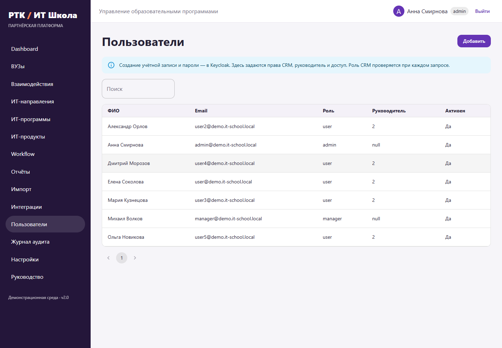
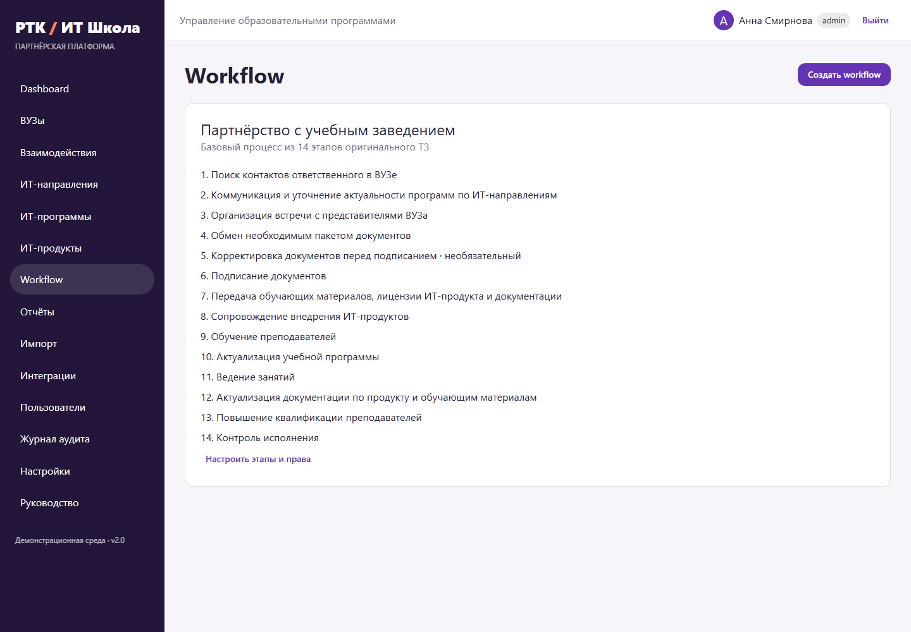
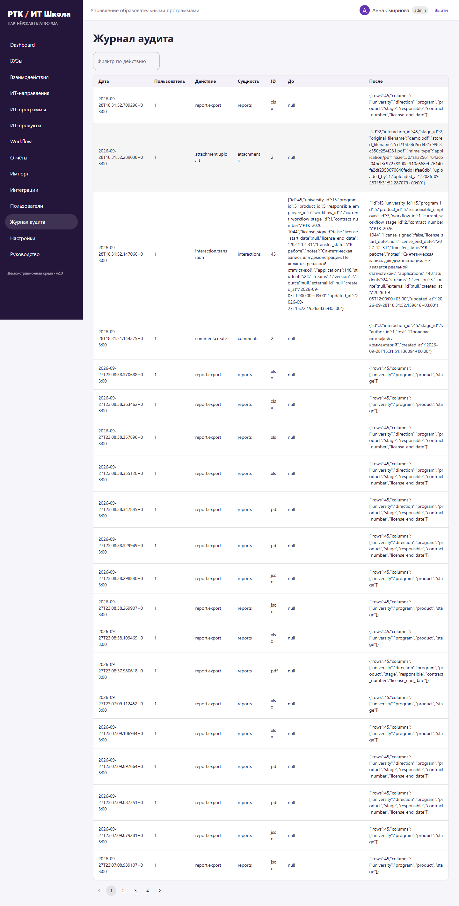

# Руководство администратора

## Первый запуск

Установите Docker Engine и Compose v2 либо Docker Desktop с Linux containers. Из корня выполните `docker compose up --build -d`. Сервисы запускаются в порядке PostgreSQL → Keycloak и Redis → миграция/seed/backend → frontend. Первый запуск требует доступа к реестрам образов и пакетам. Логи: `docker compose logs -f backend keycloak`. Готовность: `docker compose ps` и http://localhost:8000/health.

## Пользователи и роли

Realm: rostelecom-it-school. Clients: crm-frontend (public, Authorization Code + PKCE S256), crm-backend (audience). Демопрофили содержат обязательные имя, фамилию и email. Учётная запись bootstrap-admin служит для консоли Keycloak; это отдельный пользователь от admin CRM.

Для нового сотрудника создайте пользователя в realm Keycloak, установите пароль и realm role user/manager/admin. При первом входе запись Employee появится автоматически. Либо заранее внесите Keycloak ID в разделе «Пользователи». Затем в CRM задайте руководителя, локальную роль и активность. После первичной регистрации именно роль CRM определяет полномочия и проверяется в БД при каждом запросе; изменение realm role не переписывает существующую локальную роль. Для немедленного отзыва доступа выключите Employee в CRM и завершите сессии в Keycloak. Пароли меняются только в Keycloak.

USER — КАМ, менеджер по ВУЗам. MANAGER — руководитель КАМов. ADMIN — технический администратор. В seed пять КАМов с ролью user, один руководитель и один администратор. Руководитель видит непосредственно подчинённых, без рекурсивных иерархий. Назначение ВУЗа даёт доступ ко всем его взаимодействиям. Также сотрудник видит взаимодействия, где указан ответственным. Для полного снятия доступа снимите обе связи. Снятие назначения ВУЗа не удаляет исторические документы.

## Справочники и workflow

Разделы направлений, программ и продуктов поддерживают создание, редактирование и удаление. Удаление используемой записи блокируется внешними ключами. В редакторе workflow изменяются название, описание, порядок, активность, обязательность и разрешённые роли каждого этапа. Исторические этапы отключаются вместо физического удаления. Новые workflow создаются с произвольным количеством этапов, максимум 50. Изменение использующегося шаблона отражается во всех связанных взаимодействиях, история переходов сохраняется.

## Аудит и настройки

Аудит фиксирует создание/изменение/удаление сущностей, назначения, роли, workflow, переходы, импорт, синхронизацию и выгрузку отчётов. Записи содержат автора, время, тип/ID сущности, old_value и new_value. API не предоставляет удаления аудита. Настройка срока хранения носит регламентный характер и сама не удаляет данные. Размер файла задаёт MAX_UPLOAD_MB, адреса и токены интеграций — переменные окружения.

## Интеграции

INTEGRATION_MODE=mock используется по умолчанию. Для реальных сервисов задайте http, LMS_API_URL, WEBSITE_API_URL, LMS_API_TOKEN, WEBSITE_API_TOKEN и INTEGRATION_ALLOWED_HOSTS. Разрешены только HTTPS и явно разрешённые имена узлов; редиректы запрещены. Контракт — массив нормализованных объектов, описанный в API.md. Внешние секреты не попадают в исходный код. Если контракт заказчика отличается, замените LMSClient или WebsiteClient, сохранив бизнес-сервис импорта.

## Резервное копирование и восстановление

Перед обновлением сделайте логический дамп PostgreSQL и копию volume uploads. Для дампа используйте `docker compose exec -T postgres pg_dump -U crm -d crm -Fc -f /tmp/crm.dump`, затем `docker compose cp postgres:/tmp/crm.dump ./crm.dump`. Так сохраняются и CRM, и схема keycloak. Отдельно храните realm JSON, .env и файлы загрузок в защищённом месте. Redis содержит только кэш и может быть пересоздан. Проверяйте восстановление на отдельном стенде. Не выполняйте `down -v`, если данные нужно сохранить.

## Ограничения

Compose — учебный стенд с start-dev, открытым HTTP localhost и известными демопаролями. Перед production необходимы действия из SECURITY.md и DEPLOYMENT.md. Docker-сборку в исходной среде нельзя считать проверенной: установлен portable Compose CLI, но отсутствует Docker Engine. Фактические результаты проверок приведены в ACCEPTANCE.md.
