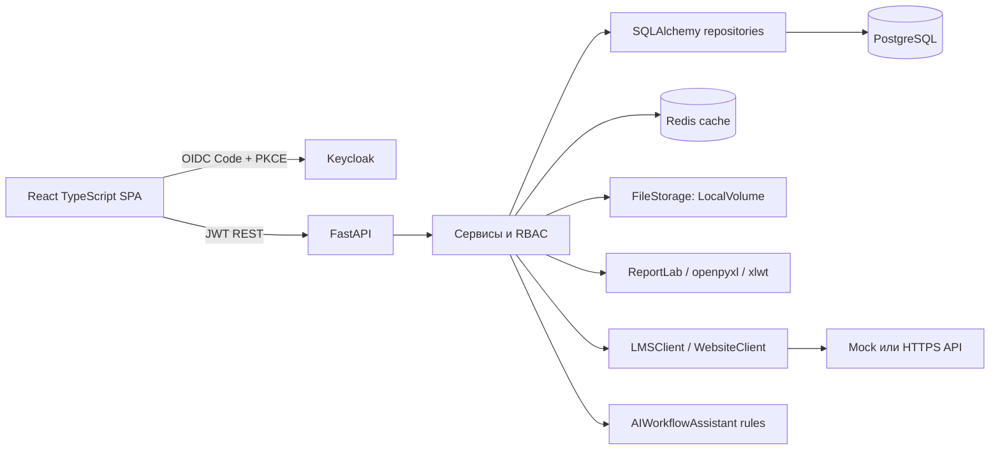
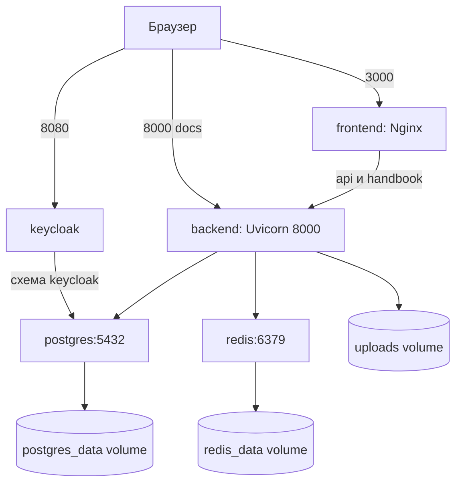
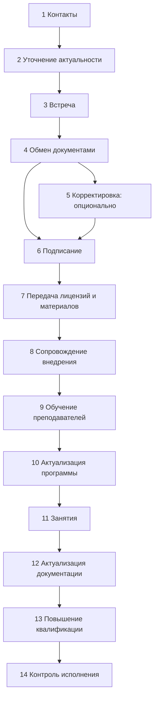
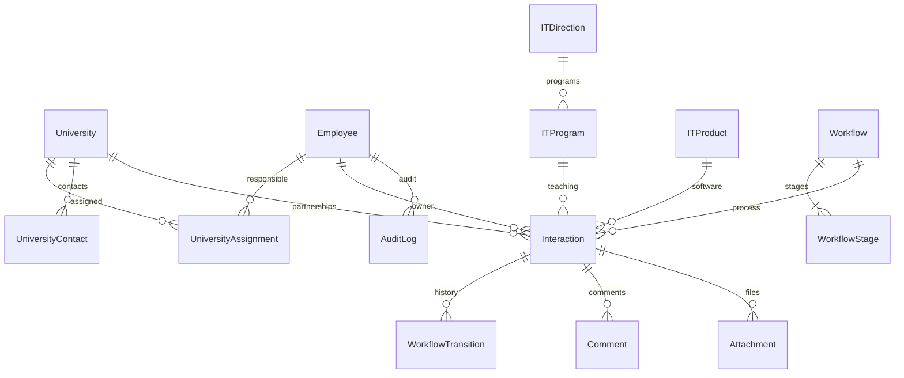

# Архитектура

## Компоненты и обработка данных

React SPA использует Router, TanStack Query, Axios, MUI и Recharts. JWT находится в памяти keycloak-js. Данные загружаются REST-запросами; изменения инвалидируют query cache без перезагрузки страницы. Фильтры, сортировка и пагинация выполняются сервером. Ограничение вариантов выбора в выпадающих списках — первая тысяча записей; большие каталоги требуют серверного autocomplete.

FastAPI API → services → repositories/SQLAlchemy → PostgreSQL. Pydantic проверяет входные и выходные DTO. SQL scope применяется до агрегации, формирования отчётов и выдачи файлов. JOIN-запросы и пакетное обогащение карточек предотвращают N+1 на списках. Версия Interaction и Workflow обеспечивает optimistic concurrency. Alembic — единственный механизм создания и изменения схемы.

Redis кэширует каталоги и агрегаты. Ключ включает ревизию, фильтры и текущую область доступа; изменение данных увеличивает ревизию. Старые значения истекают по TTL, обычно 60 секунд. Сбой Redis приводит к вычислению из PostgreSQL, а не к отказу основного функционала. Права и активность пользователя читаются непосредственно из БД.

Импорт проверяет XLS/XLSX и маппинг, преобразует типы, обрабатывает строки в savepoint. Повторный внешний импорт использует уникальный (source, external_id). Отчёты используют ту же выборку и права, что таблицы. XLSX создаёт openpyxl, XLS — xlwt, PDF — ReportLab со встроенным кириллическим шрифтом; Matplotlib экспортирует диаграммы. Архитектура синхронных worker threads поддерживает несколько отчётов одновременно; для объёмов свыше установленного лимита требуется отдельная очередь задач и object storage.

## Развёртывание

PostgreSQL и Redis не публикуют порты из Compose. Frontend запрашивает API через same-origin Nginx. Issuer Keycloak использует внешний localhost, JWKS доступен backend по внутреннему DNS. В native-проверке использовались отдельные процессы PostgreSQL/Keycloak/Uvicorn/Vite; она не заменяет сборку Linux-контейнеров.

## Базовый процесс

Эта схема — seed, а не ограничения кода. Администратор изменяет шаблоны, порядок, роли и активность. Перемещение требует текущую version и оставляет WorkflowTransition.

## Сущности

## Перенос в Archi / ArchiMate

Откройте `architecture.archimate` в Archi. Бизнес-слой: роли КАМ, руководитель, администратор; процесс «Сотрудничество с учебным заведением» и сервис «Контроль образовательных программ». Прикладной слой: SPA, CRM API, Keycloak, Reporting, Integration adapters. Объекты данных: University, Interaction, Workflow, Employee, AuditLog, Attachment. Технологический слой: браузер, Nginx, Python, PostgreSQL, Redis, volume и Linux Docker host. Связи Serving отражают обслуживание пользователя, Flow — обмен HTTP/JSON, Access — чтение/запись данных. Модель предназначена для дальнейшего уточнения инфраструктуры заказчика, доверенных зон и организационных ролей.

## Заменяемые интерфейсы

FileStorage.save/path/delete допускает замену локального адаптера на S3; при переходе на presigned URLs нужно сохранить проверку доступа в API. LMSClient/WebsiteClient.fetch_records нормализуют контракт до импорта. AIWorkflowAssistant.suggest возвращает рекомендации без изменения состояния. Реальный LLM-провайдер должен отдельно согласовать передачу персональных данных.
