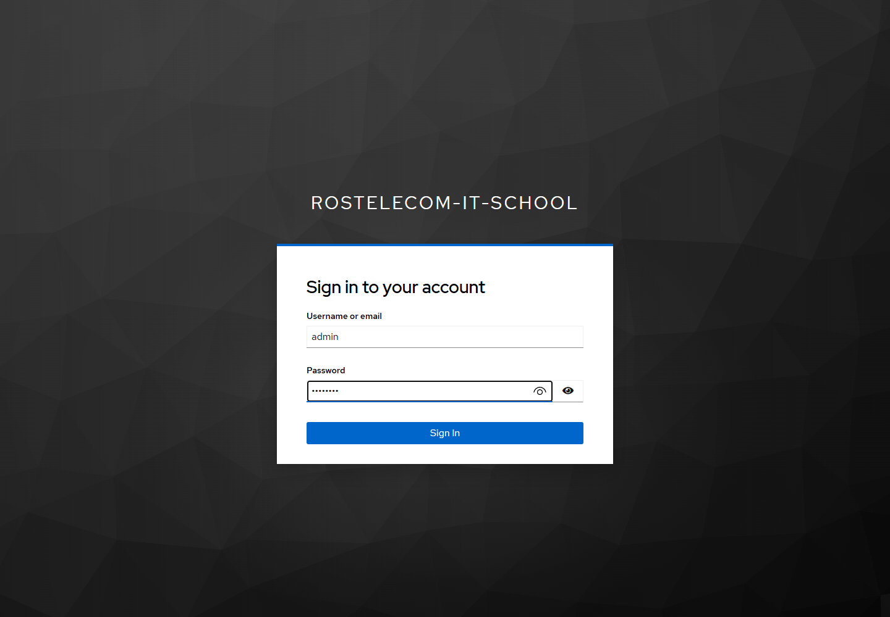
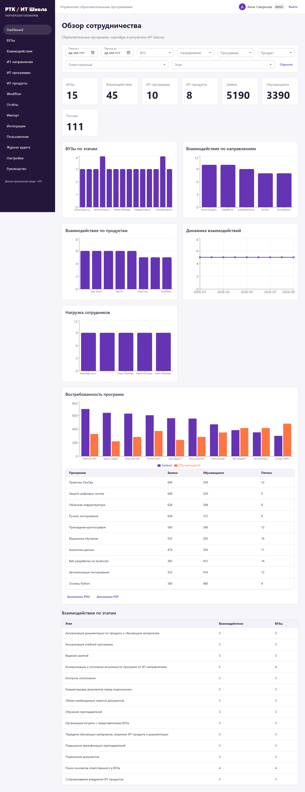
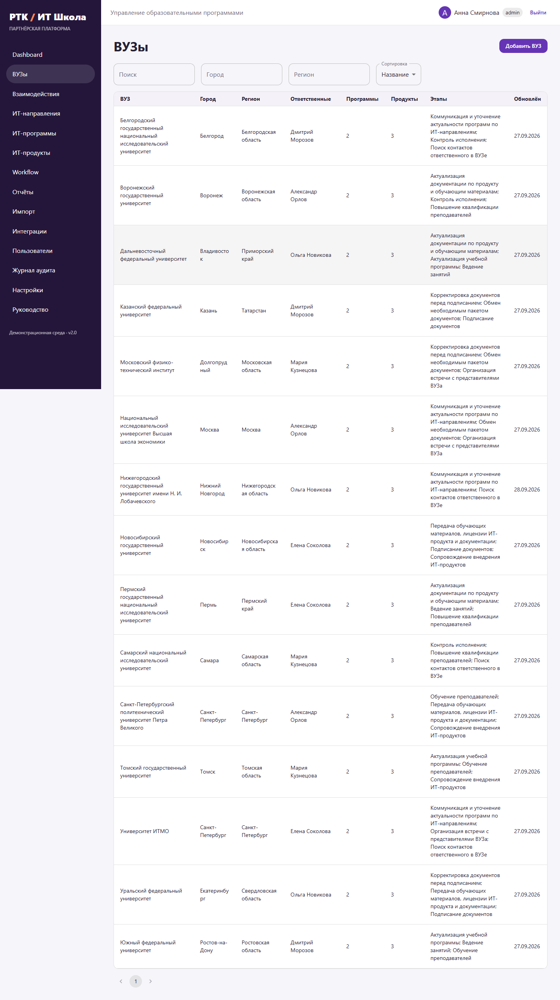
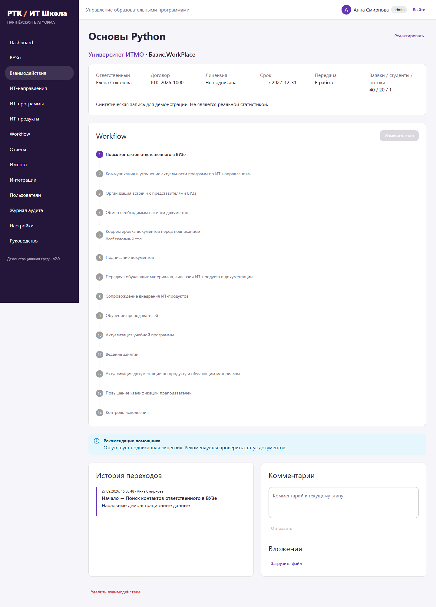
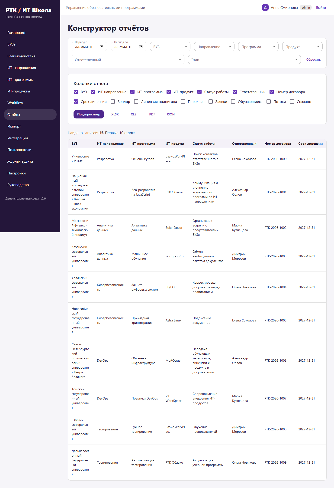
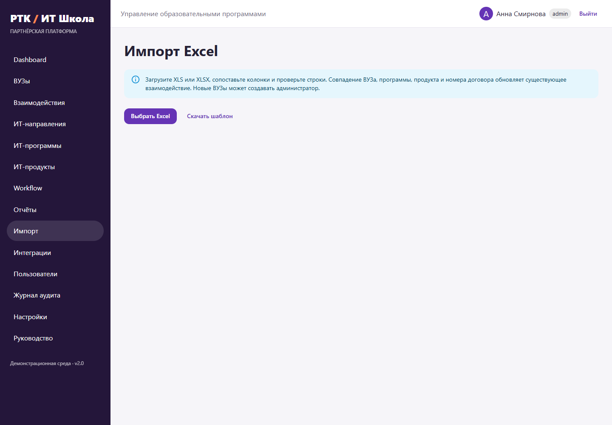
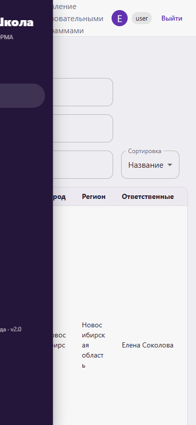

# Руководство пользователя

## Вход

Откройте http://localhost:3000. Браузер перенаправит вас в Keycloak. В учебном стенде доступны admin/admin123, manager/manager123 и user/user123. Выйти можно кнопкой в правом верхнем углу. Пароль не передаётся в CRM и не хранится в браузерном localStorage.

## Обзор и фильтры

Dashboard показывает показатели только по доступным взаимодействиям: ВУЗы, программы, продукты, заявки, обучающиеся и потоки. Период относится к дате создания взаимодействия; обе границы включены. Фильтры объединяются условием AND. «Сбросить» возвращает всю доступную выборку.

Пять графиков показывают ВУЗы по этапам, взаимодействия по направлениям, продуктам, месяцам и сотрудникам. Один ВУЗ может находиться на нескольких этапах по разным программам. Поэтому сумма ВУЗов по этапам не обязана совпадать с числом уникальных ВУЗов. Все показатели берутся из БД. Рейтинг программ упорядочен по сумме заявок; дополнительно видны обучающиеся и потоки. Диаграмма рейтинга скачивается в PNG или PDF.

## ВУЗы и контакты

Раздел «ВУЗы» поддерживает поиск, фильтры города и региона, сортировку и постраничный вывод. Нажмите строку для открытия карточки. В карточке находятся контакты, ответственные, программы, продукты, договоры, лицензии и взаимодействия. Контакт можно добавить или изменить нажатием на строку. Администратор создаёт и редактирует ВУЗы. Руководитель назначает, меняет и снимает ответственных сотрудников своей команды.

## Взаимодействие и workflow

Создайте взаимодействие, выбрав ВУЗ, программу, продукт и workflow. Оно начинается на первом активном этапе. В существующей записи можно изменить договор, даты лицензии, показатели обучения, статус передачи и примечание. ВУЗ и workflow существующей записи неизменяемы, чтобы сохранить целостность истории.

Вертикальный stepper показывает весь путь. «Изменить этап» открывает список разрешённых переходов. Пользователь идёт вперёд; необязательный этап может пропускаться. Руководитель и администратор могут корректировать путь в пределах настроенных прав. Отключённые этапы сохраняются в истории, но недоступны для новых переходов. Каждый переход содержит старый и новый этап, автора, время и комментарий.

В форме перехода можно выбрать файл. Если этап изменился, но файл не загрузился, интерфейс сообщает об этом отдельно: повторите загрузку в разделе вложений. Комментарии и файлы привязаны к этапу. При одновременной правке одной записи сервер возвращает конфликт версии: перечитайте карточку перед повторной операцией.

## Документы

Разрешены PNG, JPG/JPEG, PDF, ZIP, GZIP/GZ, RAR, DOC/DOCX, XLS/XLSX. По умолчанию максимум 20 МБ. Проверяются расширение, MIME и сигнатура. Файлы скачиваются после повторной проверки доступа. Имя в хранилище случайное. Архивы не распаковываются в пользовательские каталоги.

## Отчёты

Откройте «Отчёты», установите фильтры, отметьте колонки и нажмите «Предпросмотр». Показываются первые 10 строк и общее количество. Скачать можно XLSX, XLS, PDF или JSON. PDF содержит заголовок, период, дату формирования, фильтры и таблицу. Лимит одного отчёта — 50 000 строк; при превышении сузьте выборку.

## Импорт

Руководителю и администратору доступен раздел «Импорт». Скачайте шаблон, заполните его, загрузите XLS/XLSX. Сопоставьте колонки: обязательны ВУЗ и ПО, программа задаётся колонкой либо выбором по умолчанию. Выберите workflow для новых записей, проверьте preview и подтвердите импорт. В результате видны созданные, обновлённые, пропущенные строки и конкретные ошибки. Новые ВУЗы создаёт только администратор. ФИО менеджера должно совпадать с существующим активным сотрудником; импорт не создаёт ему учётную запись Keycloak.

Поля лицензии принимают «Да/Нет», дату или год окончания. Даты рекомендуется задавать как YYYY-MM-DD, год превращается в 31 декабря. Совпадение ВУЗа, программы, продукта и непустого номера договора обновляет запись. Без номера договора строки создаются как новые. Существующие поля, не переданные в файле, сохраняются. Каждая строка обрабатывается независимо: ошибка не отменяет удачные строки. Максимум 10 000 строк.

## Интеграции и помощник

Кнопки LMS и Website запускают синхронизацию с выбранным адаптером. В деморежиме используются стабильные тестовые записи. Повторная синхронизация опирается на source + external_id. Права текущего пользователя сохраняются, поэтому импорт недоступного ВУЗа попадёт в ошибки. Помощник в карточке предлагает проверить лицензию, договор, ответственного и отсутствие изменений более 14 дней. Он работает локально по правилам и ничего не отправляет внешней LLM.

## Ошибки и мобильная версия

401 — сессия недействительна; войдите повторно. 403 — недостаточно прав. 404 — запись отсутствует или недоступна. 409 — конфликт версии или связанных данных. 413 — файл слишком большой. 415 — неподдерживаемый файл. 422 — некорректные поля. При проблеме подключения повторите действие после восстановления связи. На телефоне меню открывается кнопкой слева сверху; широкие таблицы прокручиваются горизонтально.

